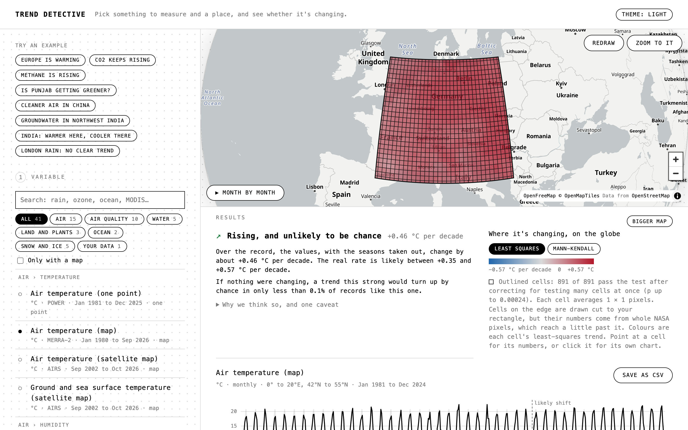
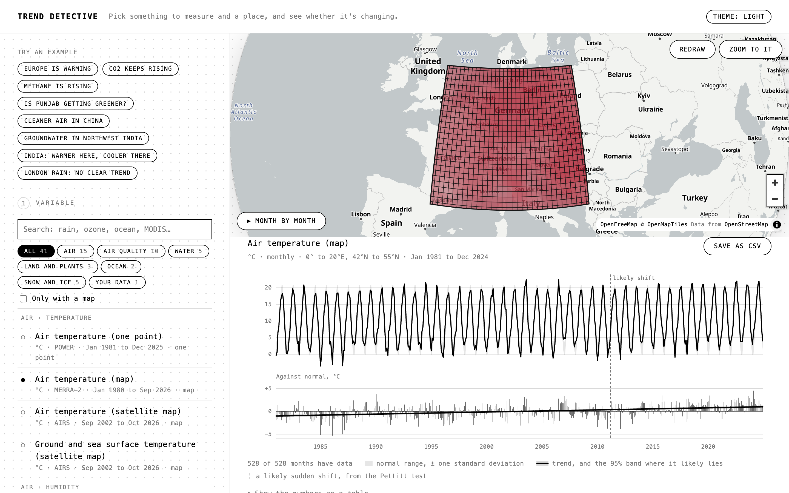
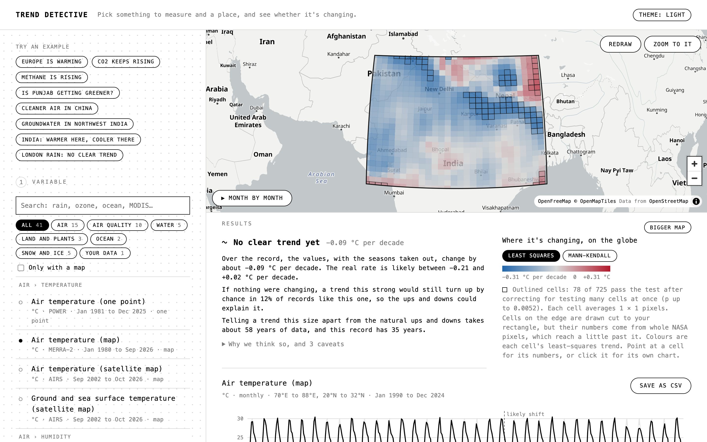
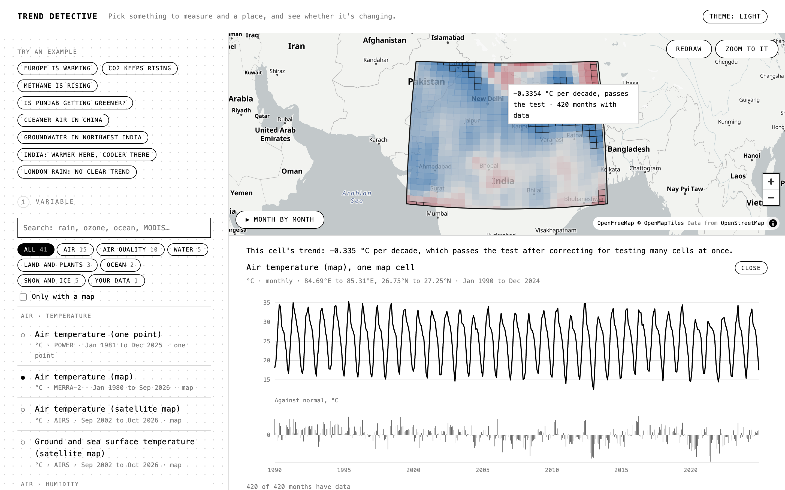
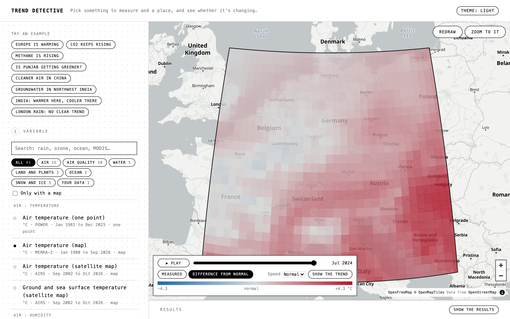
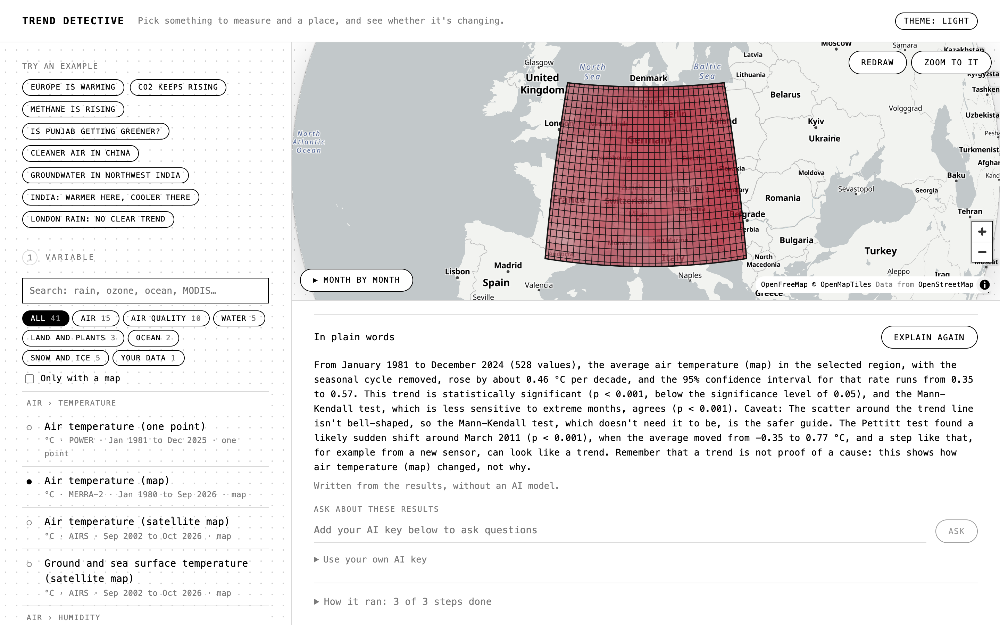

# Trend Detective

Our entry for NASA Space Apps 2026, [Be An Earth System Trend Detective!](https://www.spaceappschallenge.org/2026/challenges/earth-system-trend-detective/).

Pick one of 40 things to measure, such as air temperature, sea ice, methane, groundwater or NO2, draw a rectangle on the globe and pick the years. Trend Detective fetches the data from NASA, removes the seasonal cycle and tells you, in plain words, whether it's changing, how fast, and how likely that is to be chance. For map variables it also shows where inside the rectangle the change is, and lets you play the months back on the globe.

It's written for high-school students: every number comes with a sentence saying what it means, and the caveats sit next to the result.

## Demo video

https://github.com/user-attachments/assets/8b5c816f-39f9-4e28-94b7-072951ba995d

## Screenshots

| | |
|---|---|
|  |  |
| **The verdict**, and where it's changing. this part of Europe has warmed by about 0.46 °C per decade since 1981 | **The chart:** the monthly values, how far each month was from normal, and the trend with its band |
|  |  |
| **The trend map:** India is warmer here and cooler there. Outlined cells pass the test | **One cell:** click a cell for its own chart |
|  |  |
| **Month by month:** play the record back on the globe, here July 2024 against normal | **In plain words:** the results as a paragraph, written without an AI model |

More in [assets/](assets): the start screen, the shuffle test, the trend over every stretch of years, which months changed, and the dark theme.

## Try it

You need Docker, and a free [Earthdata Login](https://urs.earthdata.nasa.gov) account.

```
make up              # the first run creates .env: put your EARTHDATA_TOKEN in it, then run make up again
make warm-examples   # fetches the examples' NASA data once; the first run can take a while
```

Then open [http://localhost:3000](http://localhost:3000) and press one of the examples under "Try an example". [Running it](#running-it) has the details, including the one-time approval GES DISC needs and the AppEEARS login.

## How it meets the challenge

| The challenge asks for | Where it is in Trend Detective |
|---|---|
| Choose Earth science variables | 40 variables in a browser like Giovanni's: search, topics and measurements, a plain definition for each, and a filter for the ones with a map |
| Get the data for a region | Draw a rectangle on the globe or type its edges. The data comes live from NASA Harmony, Giovanni, POWER and AppEEARS, and is cached afterwards |
| A time series and a visualisation | The region's monthly chart, with the normal range, anomaly bars and the trend with its band. For map variables, a heatmap of the trend in every cell, and the months played back on the globe |
| The trend's rate and whether it's significant | Least squares with an autocorrelation correction, its confidence interval and p-value, with Mann-Kendall and Sen's slope alongside. On the map, a test per cell with a false discovery rate correction |
| Take out the seasonal cycle | Every test runs on anomalies, each month's difference from its own normal |
| For students and the public | Every number comes with a sentence. Caveats sit next to the result, and "Why we think so" shows the evidence as charts |
| Demo walkthroughs | Eight examples, one click each, from Europe warming to London rain with no clear trend |
| "A trend may need a longer record to become significant" | The verdict says how many years it would take to tell, and a record under 10 years is never called a trend |
| Help from AI | "In plain words" writes an overview from the numbers without any AI model. Questions about the results work with your own AI key, and any number in an answer that isn't in the results is flagged |

## What it does

- **A variable browser.** Like Giovanni's: search, topics (air, air quality, water, land and plants, ocean, snow and ice) and measurements, and a filter for the ones with a map.
- **Choose what to make.** The region's chart always comes; the trend tests, the trend map and the month-by-month map are each optional, so a quick look at the map skips the tests.
- **One answer up top.** "Rising, and unlikely to be chance", "Falling…" or "No clear trend yet", with the rate per decade, the range it likely falls in, and how often chance alone would give a trend this strong. Under 10 years of record, a passing test reads "too short to call a trend".
- **Where it's changing.** For map variables, a heatmap on the globe colours each cell by its own trend, from least squares or Mann-Kendall at the press of a button. Cells that still pass after correcting for testing hundreds of cells at once are outlined. Clicking a cell opens its own chart.
- **Month by month.** A time slider plays the grid back, as measured values or as the difference from normal, so you can watch a trend build up, or a heatwave pass.
- **Why we think so.** The shuffle test as a histogram, a triangle of the trend over every stretch of years to show whether the answer hangs on the years picked, and which months of the year changed. Plus the caveats the tests raised: short records, a sudden shift, unusual months.
- **The chart.** The region's monthly values and anomalies, with the fitted trend and its band, unusual months ringed and a likely sudden shift marked, a crosshair, a table view, and a CSV download.
- **Examples.** One click runs a curated case: Europe warming, CO2 rising, methane rising over the Ganges plain, cleaner air over China, groundwater falling in northwest India, farmland greening in Punjab, a mixed picture over India, and London rain with no clear trend.
- **In plain words.** An explanation of the results, written from the numbers without any AI model. Questions about them work with your own Anthropic or OpenAI-compatible key, which stays in the page.
- **Your own data.** Upload a CSV of dates and values and run the same tests on it.

## Where the data comes from

All from NASA, fetched live when a job runs and cached afterwards.

| Service | Variables | What we ask it for |
|---|---|---|
| [Harmony](https://harmony.earthdata.nasa.gov) | From MERRA-2, back to 1980: air and sea surface temperature, humidity, water vapour, cloud cover, sunlight, wind, sea-level pressure, rain, snowfall, snow cover, sea ice, ozone, carbon monoxide, and haze, dust, smoke and sulfate particles. From GLDAS: soil moisture at the top and in the root zone, soil temperature, evaporation, runoff, snow water and snow depth. Rain and snow from GPM IMERG | The rectangle cut out of each monthly file, for the maps |
| [Harmony](https://harmony.earthdata.nasa.gov) | From AIRS, the infrared sounder on NASA's Aqua satellite, since 2002: water vapour, air and surface temperature, cloud cover, ozone, and methane as a column average | The rectangle cut out of each monthly file, for the maps |
| [Harmony](https://harmony.earthdata.nasa.gov) | Ocean chlorophyll from NOBM, 1998 to 2015 | Each month's file by its ID, cut to the rectangle, for the map |
| [Giovanni](https://giovanni.gsfc.nasa.gov) | NO2 (OMI), groundwater (GLDAS), CO2 (OCO-2), and chlorophyll as a second source | The rectangle's average over time |
| [POWER](https://power.larc.nasa.gov) | Air temperature, rain and snow | A point's monthly series |
| [AppEEARS](https://appeears.earthdatacloud.nasa.gov) | Plant greenness (MODIS NDVI), land surface temperature (MODIS) | The rectangle's statistics per image |

## How it decides

The tests run on anomalies, each month's difference from its own normal, so the seasons don't pass for a trend.

- **Least squares** on time, with the effective sample size correction for autocorrelation (Santer et al. 2000).
- **Mann-Kendall** with the Hamed and Rao correction, and Sen's slope. The verdict says when it and least squares disagree.
- **A block shuffle test**: the record cut into years, shuffled 1,000 times, refitted each time.
- **The Pettitt test** for a sudden shift, residual checks and outlier months, all reported as caveats.
- **The trend triangle**, the trend over every stretch of at least 10 years, and **years to significance** (Weatherhead et al. 1998).
- **Each month of the year** tested on its own, to show which seasons changed.
- **On the map**, a test per cell, then the Benjamini-Hochberg false discovery rate across cells (Wilks 2016).
- **Short records:** under 10 years, a test that passes isn't called a trend, in the app or in the plain-words explanation, since a few unusual months can make one look real.

As a check, run on NOAA's Mauna Loa CO2 record, our trend comes within 0.02 ppm a year of the growth NOAA publishes for 2010 to 2019 and for 2000 to 2024. The methods and their sources are in [services/analysis/README.md](services/analysis/README.md), and the whole system in [ARCHITECTURE.md](ARCHITECTURE.md). Tasks and decisions live in the team's Notion.

## How it's built

```
browser ── Connect ──▶ gateway ◀── NATS JetStream ──▶ ingest → preprocess → analysis
   │                     │                                        │
   │                     ├── job state in Redis                   ├── fetches from NASA
   │                     └── narrator, for the explanations       │
   └──── downloads results ──────────────────────────▶ files in SeaweedFS (S3)
```

- **The web app** (React, MapLibre and d3) talks to **the gateway** over Connect, and follows a job through a stream.
- **The gateway** (Go) owns the catalog of variables and every job's state, and hands out work over NATS JetStream.
- **Ingest** (Go) fetches from NASA: Harmony, Giovanni, POWER and AppEEARS.
- **Preprocess** (Python) cleans and averages the files into a series and a grid.
- **Analysis** (Python) runs the tests.
- **The narrator** (Go) writes the plain-words explanation.

Files pass between the stages through SeaweedFS, an S3 store, and the browser downloads its results straight from there. Contracts are Protocol Buffers in `proto/`. Everything runs in Docker Compose. [ARCHITECTURE.md](ARCHITECTURE.md) has the whole design.

## Layout

```
.
├── ARCHITECTURE.md
├── LICENSE                                 MIT
├── assets/                                 screenshots for this README
├── compose.yaml, .env.example               the local stack and its settings
├── Makefile                                up, down, logs, gen, lint and more
├── buf.yaml, buf.gen.yaml                  buf module and codegen settings
├── package.json, bun.lock, bunfig.toml     Bun workspace for the web app
├── go.mod                                  one Go module for gen/go, gateway and ingest
├── proto/trenddetective/<service>/v1/      contracts, one package per owning service
├── gen/                                    generated Go, Python and TS code, committed
├── deploy/                                 NATS, Redis and SeaweedFS configs, bootstrap container
└── services/
    ├── gateway/      Go. Orchestrates jobs, owns job state and the browser API
    ├── ingest/       Go. Fetches raw files from NASA sources
    ├── preprocess/   Decodes, cleans and aggregates data into series and grids
    ├── analysis/     Trend tests on series and grid cells
    ├── narrator/     Optional LLM explanations, bring your own key
    └── web/          TypeScript, React and Vite, built with Bun. Map, charts, the job runner
```

## Running it

You need Docker. Then:

```
make up
```

The first run copies `.env.example` to `.env`. Put your Earthdata token in it as `EARTHDATA_TOKEN`. You get one at [urs.earthdata.nasa.gov](https://urs.earthdata.nasa.gov) under "Generate Token". The same account also has to approve the [NASA GESDISC DATA ARCHIVE](https://urs.earthdata.nasa.gov/approve_app?client_id=e2WVk8Pw6weeLUKZYOxvTQ) app once, or GPM and MERRA-2 requests fail with 403.

AppEEARS logs in with an Earthdata account rather than the token, so the MODIS variables also need `EARTHDATA_USERNAME` and `EARTHDATA_PASSWORD` in `.env`.

`make up` starts NATS, Redis and SeaweedFS, runs bootstrap to create the JetStream streams and the S3 buckets, and starts ingest, preprocess, analysis, the narrator, the gateway and the web app. Run `make warm-examples` once to fetch every example's data from NASA, which can take a while the first time. Then open [http://localhost:3000](http://localhost:3000) and press one of the examples, or pick a variable, draw a rectangle and press Fetch the data. A first run of a long record can take several minutes while NASA prepares the files; the same request again comes from the cache. To try the API with curl, see [services/gateway/README.md](services/gateway/README.md). Other targets:

| Target | What it does |
|---|---|
| `make up-obs` | `make up` plus Jaeger, Prometheus, Grafana and Pyroscope. See [Observability](#observability) |
| `make down` | Stops everything, the observability stack too. Data stays in the Docker volumes |
| `make logs` | Follows the logs |
| `make ps` | Lists the containers |
| `make clean` | Stops everything and deletes all data |
| `make test` | Runs the Go unit tests |
| `make test-preprocess`, `make test-analysis` | Runs a Python service's lockfile check, lint and unit tests. Needs uv |
| `make smoke` | With the stack up, runs the Delhi bundle through each stage and checks the results |
| `make smoke-harmony` | Runs a real GPM job through NASA Harmony. Needs `EARTHDATA_TOKEN` in `.env` |
| `make smoke-power` | Runs a real job through NASA POWER. Needs no token |
| `make smoke-giovanni` | Runs a real point job through NASA Giovanni. Needs `EARTHDATA_TOKEN` in `.env` |
| `make smoke-appeears` | Runs a real NDVI job through NASA AppEEARS. Needs `EARTHDATA_USERNAME` and `EARTHDATA_PASSWORD` in `.env`, and 5 to 15 minutes |
| `make warm-examples` | With the stack up, runs every "Try an example" job once, so they finish in seconds in the app. The first run waits on NASA, from minutes to an hour for AppEEARS |
| `make web-dev` | Runs the web app with hot reload on http://localhost:5173, against the running stack. Needs [Bun](https://bun.sh) |
| `make web-check` | The web app's type check, unit tests and production build |

The ports listen on 127.0.0.1 only:
- NATS: 4222, and 8222 for monitoring.
- Redis: 6379.
- SeaweedFS: 8333 for S3, 9333 for the master UI, and 8888 for the filer UI.
- Gateway: 8080, the Connect API.
- Narrator: 8081, the Connect stream the gateway proxies.
- Web app: 3000, and 5173 for `make web-dev`.
- With `make up-obs`: Grafana 3001, Jaeger 16686 (and 4318 for OTLP), Prometheus 9091, Pyroscope 4040.

### Observability

`make up-obs` starts the stack with the `obs` compose profile. Without it none of this runs, and the services behave as with `make up`.

- [Grafana](http://localhost:3001) opens on the Trend Detective dashboard: which services are up, HTTP requests, 5xx errors and p95 latency per Connect procedure, and ingest tasks by outcome. Prometheus, Jaeger and Pyroscope are set up as data sources, so Explore reaches all three. No login; the port is local only.
- [Jaeger](http://localhost:16686) has the traces. Each gateway request is a span, and a job's ingest task, and a Narrate call to the narrator, join the same trace.
- [Prometheus](http://localhost:9091/targets) scrapes `/metrics` on the gateway, ingest and the narrator.
- [Pyroscope](http://localhost:4040) has CPU, memory and goroutine profiles of the same three, pulled by Grafana Alloy.

Preprocess and analysis, in Python, aren't covered yet: they carry the trace ID into their logs, but send no spans or metrics. Their time shows up as the gap between ingest's span and the job's end.

## Working here

- Each service has its own folder and Dockerfile. Its owner decides what goes inside.
- A contract change goes in `proto/`. Run `make gen` and commit the generated code in the same PR.
- Never commit `.env`.

## Credits

- Data: NASA's Harmony, Giovanni, POWER and AppEEARS services, and the GES DISC, LP DAAC and other archives behind them. The catalog, `services/gateway/catalog.yaml`, links each variable's dataset page.
- Maps: [OpenStreetMap](https://www.openstreetmap.org/copyright) contributors, through [OpenFreeMap](https://openfreemap.org), drawn with [MapLibre GL JS](https://maplibre.org).

## License

[MIT](LICENSE). The NASA data the app fetches keeps its own terms; see each dataset's page.
